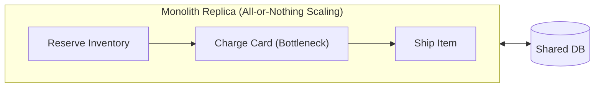
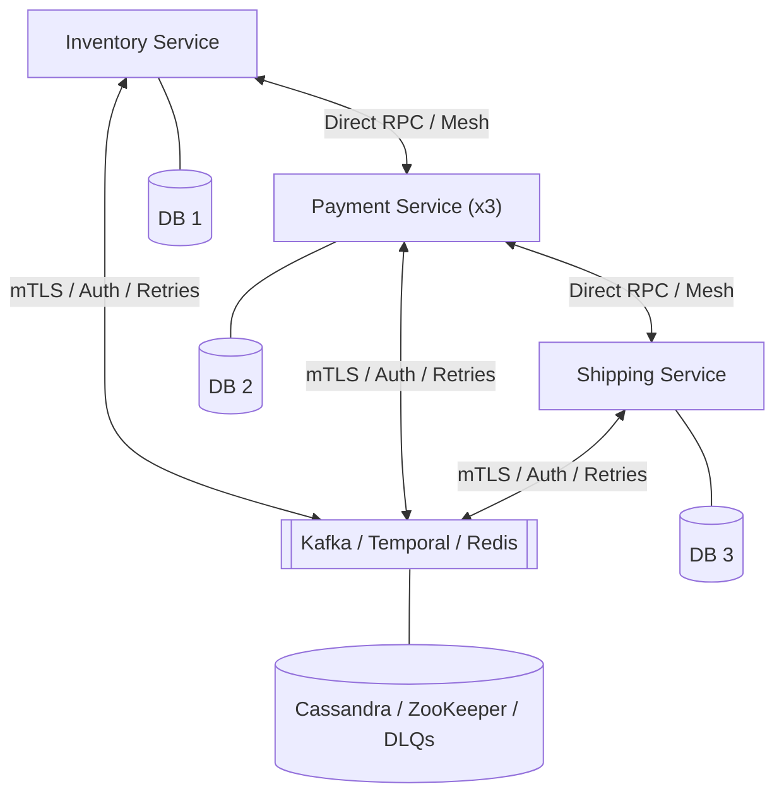
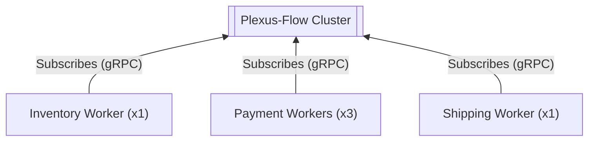
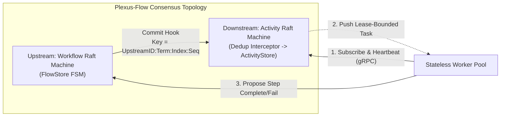

# Plexus-Flow

[](https://golang.org)
[](https://github.com/avivklas/plexus)
[-green.svg)](https://github.com/avivklas/plexus)
[](https://avivklas.github.io/plexus-flow/)

**Distributed Sagas & Multi-Step Workflow Orchestration without Temporal, Kafka, or fragile Redis locks.**

`plexus-flow` is a distributed workflow engine built on the **Plexus Raft Graph**. Start as a single binary with zero external dependencies, and independently scale any step horizontally by spinning up stateless worker processes—without managing service discovery, inter-service RPCs, message brokers, or distributed locks.

> 🌐 **[Live Interactive Website & Pipeline Simulator](https://avivklas.github.io/plexus-flow/)** | 📚 **[Full Developer Documentation](https://avivklas.github.io/plexus-flow/docs.html)**
>
> Curious how `plexus-flow` solves dual writes, zombie workers, and split-brain without external brokers—and what the trade-offs are? Jump to [**Under the Hood: Distributed Systems Guarantees & Trade-offs**](#under-the-hood-distributed-systems-guarantees--trade-offs).

---

## Architecture Comparison: Monolith vs. Microservices vs. Plexus-Flow

### 1. Monolith — *Simple communication, hard to scale*
All steps are tightly coupled in one process. To scale a single CPU-heavy step (e.g., `charge-card`), you must duplicate the entire application and scale database connections with it. A process crash mid-flight loses in-memory execution state.



### 2. Microservices — *Granular scaling, operational & communication nightmare*
Each step is a separate service. Scaling is granular, but now every service needs service discovery, load balancers, mTLS/IAM policies, schema contracts, retry/circuit-breaker logic, idempotency tables, and external message brokers or orchestrators (Kafka, Temporal, Redis) just to talk to the next step and roll back on failure.



### 3. Plexus-Flow — *Monolith simplicity, per-step scaling, zero inter-service plumbing*
Workers **never talk to each other** and **never expose ingress ports**. `plexus-flow` owns workflow state, routing, deduplication, and LIFO Saga rollbacks. Activities can run **in-process** (like a monolith) and seamlessly burst out to **stateless remote workers** (in Go, Python, etc.) that subscribe over an outbound gRPC stream to pull work for specific steps.



---

## Why Plexus-Flow Wins on Deployment & Maintenance

| Dimension | Monolith | Microservices (Temporal / Kafka / Redis) | Plexus-Flow |
|---|---|---|---|
| **Scaling Granularity** | **Coarse:** Must clone the entire binary & DB pool to scale one slow step. | **Fine-grained,** but requires deploying & autoscaling full independent services. | **Per-step & elastic:** Run steps in-process by default; spin up stateless workers only for bottleneck activities. |
| **Inter-Service Communication** | Function calls in memory. | **High friction:** Service mesh, DNS/discovery, API versioning, circuit breakers, DLQs. | **Zero inter-service calls:** Workers never know about each other; `plexus-flow` pipes outputs to downstream inputs. |
| **Network & Access Control (Firewall/IAM)** | Single ingress; shared internal DB credentials. | **$O(N^2)$ ACLs:** mTLS certs, IAM roles, and firewall rules between every service pair and broker. | **Outbound-only workers:** Workers open no listening ports and need no service discovery—just subscribe to the cluster's gRPC address. |
| **Infrastructure Tax** | 1 App + 1 DB. | App fleet + Kafka + Temporal Server + Cassandra/Postgres + Redis. | **Zero external dependencies:** Consensus, storage, deduplication, and UI are embedded in the binary. |
| **Failure, Liveness & Rollback** | Lost on crash unless manually checkpointed to DB. | Custom compensation consumers, orphan sweepers, and manual lock timeouts. | **Built-in:** Automatic LIFO Saga compensation, worker heartbeats, dead-worker task redelivery, and step timeouts. |
| **Exactly-Once Semantics (EOS)** | Local DB transactions only; manual keys for external APIs. | Manual idempotency keys and deduplication tables in every microservice. | **Native EOS:** Deterministic Raft Graph keys (`UpstreamID:Term:Index:Seq`) enforced before dispatch. |
| **Safe Rollouts & Versioning** | Redeploy everything for a one-line change; risky migrations. | Coordinate multi-repo deployments and backward-compatible RPC schemas. | **Decoupled:** Upgrade or restart stateless activity workers at any time; the cluster buffers and redelivers in-flight tasks. |
| **Observability** | Single log stream / stack trace. | Stitch OpenTelemetry/Jaeger traces across dozens of queues and services. | **Built-in Flow & Trace Dashboard** + live SSE push streams out of the box. |

---

## Built-in Visibility: Flow & Trace Dashboard

In a monolith, business logic is hidden inside code branches; in microservices, it is scattered across repositories, message queues, and stitched-together OpenTelemetry spans.

A service built with `plexus-flow` is **self-describing**—just as a REST API schema tells you what endpoints exist, `plexus-flow` automatically exposes the complete **flow** (every activity and transition, including failure and rollback paths) and overlays live **traces** of actual runs directly on top of it. Zero external tracing infrastructure (Jaeger, Datadog, Zipkin) required.

Every node serves the interactive dashboard out of the box at `/`:

```bash
go run ./examples/ordersaga --simulate-failure --fail-step ship-order --serve --http-addr 127.0.0.1:8080
# open http://127.0.0.1:8080
```

### 1. Flow View — *The Shape of Your Business Logic*
Derived automatically from your step dependencies and compensating actions—with nothing extra to declare. Solid grey edges show the happy path, red dashed edges show failure transitions, and amber nodes show the compensating actions that undo completed steps in reverse order. Click any node to inspect its activity, retries, timeout, dependencies, and compensation.


### 2. Traces View — *Live Execution & Rollback Inspection*
The exact same graph overlaid with a real execution: the path taken is highlighted and numbered step-by-step, untaken branches are faded, and each node displays its duration, attempt count, inputs/outputs, and errors. A live timeline below tracks execution progression in real time over Server-Sent Events (SSE).


---

## Quick Start

### 1. Run the Production Server

```bash
# Build the production server binary
go build -o bin/plexus-flow ./cmd/plexus-flow

# Start a single-node server (HTTP API & Web UI on :8080, gRPC Worker Broker on :9090)
./bin/plexus-flow \
  --id node-1 \
  --http-addr :8080 \
  --grpc-addr :9090 \
  --raft-addr 127.0.0.1:7001 \
  --act-raft-addr 127.0.0.1:7002 \
  --data-dir ./data/node-1
```

### 2. Run the Standalone Showcase Examples

```bash
# Run happy-path E-Commerce Order Fulfillment Saga
go run ./examples/ordersaga

# Run automatic LIFO Saga rollback demo (simulates failure & reverse-order compensation)
go run ./examples/ordersaga --simulate-failure --fail-step charge-payment

# Run Autonomous ML Canary Release Pipeline (Fork-Join DAG + Conditional Branching + Signal Gate + Cron)
go run ./examples/mlrelease
```

---

## Defining a Saga in Go

Activities run in-process via `worker.Registry`, or on remote workers subscribing over gRPC (`pkg/remote`)—the workflow definition stays identical:

```go
package main

import (
	"context"
	"encoding/json"
	"log"

	"github.com/avivklas/plexus-flow/pkg/flow"
	"github.com/avivklas/plexus-flow/pkg/flowstore"
	"github.com/avivklas/plexus-flow/pkg/graphflow"
	"github.com/avivklas/plexus-flow/pkg/worker"
)

func main() {
	registry := worker.NewRegistry()

	registry.Register("reserve-inventory", func(ctx context.Context, in json.RawMessage) (json.RawMessage, error) {
		return json.RawMessage(`{"reserved": true}`), nil
	})
	registry.Register("release-inventory", func(ctx context.Context, in json.RawMessage) (json.RawMessage, error) {
		return json.RawMessage(`{"released": true}`), nil
	})
	registry.Register("charge-card", func(ctx context.Context, in json.RawMessage) (json.RawMessage, error) {
		return json.RawMessage(`{"charged": true}`), nil
	})
	registry.Register("refund-card", func(ctx context.Context, in json.RawMessage) (json.RawMessage, error) {
		return json.RawMessage(`{"refunded": true}`), nil
	})

	coord, err := graphflow.NewEmbeddedCoordinator(registry)
	if err != nil {
		log.Fatal(err)
	}
	defer coord.Close()

	def := flow.WorkflowDefinition{
		Name: "ecommerce-order-saga",
		Steps: []flow.StepDefinition{
			{Name: "step-inventory", Activity: "reserve-inventory", CompensatingAction: "release-inventory"},
			{Name: "step-payment", Activity: "charge-card", CompensatingAction: "refund-card"},
		},
	}

	_, err = coord.StartWorkflow(context.Background(), flowstore.StartWorkflowRequest{
		WorkflowID: "order-1001",
		Definition: def,
		Input:      json.RawMessage(`{"amount": 149.99}`),
	})
	if err != nil {
		log.Fatal(err)
	}
}
```

### Push Watchers & HTTP API (`pkg/api`)

Instead of polling, clients subscribe to Server-Sent Events (SSE) pushed on every state transition:

```go
final, err := client.WaitWorkflow(ctx, "order-1001") // Go SDK: blocks until terminal state
```

```python
from plexus_flow import wait_for                    # Python SDK (stdlib only)
final = wait_for("http://127.0.0.1:8080", "order-1001")
```

| Endpoint | Description |
|---|---|
| `POST /api/v1/workflows/start` | Start a new workflow instance (transparently forwarded to leader if sent to a follower) |
| `GET /api/v1/workflows/{id}` | Get workflow state from hot memory or cold archive (`POST .../signal`, `POST .../cancel`) |
| `POST /api/v1/workflows/{id}/replay` | **Time-Travel Step Replay:** Reset a step (and its downstream DAG) to `PENDING` with optional patched JSON input and re-execute |
| `GET /api/v1/workflows/search` / `POST /api/v1/workflows/search` | **Zero-CDC Faceted Search:** Full-text, `key:value`, status, error code, metadata, and JSON payload queries with live facet counts |
| `GET /api/v1/workflows/{id}/watch` | SSE stream of state changes until terminal status |
| `POST /api/v1/workflows/compact` | Archive terminal workflows to cold disk storage and compact hot Raft memory |
| `GET /api/v1/schedules` / `POST /api/v1/schedules` | List or upsert durable cron (`*/5 * * * *`) & interval (`@every 10s`) schedules |
| `DELETE /api/v1/schedules/{id}` | Delete a durable schedule |
| `GET /api/v1/flows` / `GET /api/v1/flows/{name}` | List known flows and inspect DAG + conditional `When` guards + compensation edges |
| `GET /api/v1/traces/{workflowID}` | Execution trace overlaid on the flow graph |

---

## Why Engineering Teams Switch from Temporal to Plexus-Flow

1. **Zero Determinism Tax (No `NonDeterministicError`):** Temporal re-executes your workflow code from line 1 on every state transition and crashes if a deployment changes a log line, map iteration, or `time.Now()` call without `workflow.GetVersion` gates. In `plexus-flow`, the DAG state machine lives inside Raft—your activities are ordinary functions (`worker.RegisterTyped[In, Out]`) that can be deployed and updated at any time without breaking in-flight workflows.
2. **Declarative Conditional Branching (`flow.Condition`):** Route execution dynamically (`When: &flow.Condition{Source: "input", Field: "amount", Op: flow.OpGT, Value: 1000}`) based on workflow input, metadata, or upstream step JSON outputs (`eq`, `ne`, `gt`, `gte`, `lt`, `lte`, `in`, `exists`, `not_exists`). Untaken branches are automatically marked `SKIPPED` while downstream join steps still advance cleanly.
3. **Time-Travel Step Replay & Input Patching (`/replay`):** When a 10-step workflow fails on step 8 due to a bad payload or downstream outage, fix the bug or patch the step's JSON input and call `ReplayStep(ctx, workflowID, "step-8", patchedInput)`. Steps 1–7 stay `COMPLETED` while step 8 and its downstream dependents re-run immediately.
4. **Zero-CDC Sub-Millisecond Search & Facets (`/workflows/search`):** Temporal requires running Elasticsearch/OpenSearch + Kafka CDC pipelines just to filter workflows by custom attributes. `plexus-flow` indexes workflow state directly in its Raft memory—query by free-text, `meta.region:eu`, `error_code:CARD_DECLINED`, or nested JSON input predicates with zero replication lag and built-in facet aggregations.
5. **1 Binary vs. 7 Infrastructure Services:** Replace Temporal Server (Frontend, History, Matching, Worker) + Cassandra/Postgres + Elasticsearch + Kafka with a single embedded or clustered Go binary.

---

## Production Execution Primitives

- **Generics-First Typed Activity SDK (`worker.RegisterTyped[In, Out]`):** Write strongly-typed Go structs (`func(ctx context.Context, in ChargeReq) (ChargeResp, error)`) with automatic JSON marshaling/unmarshaling alongside raw `json.RawMessage` handlers.
- **Declarative Conditional Branching (`StepDefinition.When`):** Evaluate predicates against `"input"`, `"metadata"`, or `<upstream-step-name>` outputs (including `$status`) at dispatch time without replay determinism constraints.
- **Time-Travel Step Replay (`CmdReplayStep`):** Reset any failed, compensated, or completed step (and its transitive downstream dependents) to `PENDING` with optional patched input and immediately re-dispatch through the Raft Graph.
- **Zero-CDC Workflow Search & Facets (`Store.SearchWorkflows`):** Sub-millisecond full-text, `key:value` token, metadata, status, error code, duration, and nested JSON `InputMatch` filtering with automatic `status`, `flow`, and `error_code` facet counts.
- **Attempt & RunID Zombie Worker Fencing:** Every step dispatch increments a monotonic `Attempt` token and binds to `RunID`. Both the upstream `FlowStore` FSM and downstream `ActivityStore` enforce `Attempt` + `RunID` fencing so delayed completions or failures from partitioned/zombie workers can never overwrite a retried or replayed step.
- **Deterministic Raft FSM Timestamps (`At` & `DedupStore` Snapshotting):** Proposals stamp wall-clock timestamps (`req.At`) before Raft replication so every replica produces byte-identical state and history across snapshots, and `ActivityStore` snapshots/restores its `DedupStore` state atomically.
- **Exponential Retry Policy & Error Filtering (`flow.RetryPolicy`):** Per-step `InitialInterval`, `BackoffCoefficient`, `MaxInterval`, and `NonRetryableErrorCodes` (immediately triggering failure/Saga compensation without burning retries on `4xx` or validation errors).
- **Heartbeat Progress Checkpointing (`workerclient.ReportProgress`):** Long-running remote workers can stream arbitrary JSON progress checkpoints inside gRPC heartbeats. If a worker crashes mid-flight, the replacement worker receives `TaskInfo.LastProgress` to resume from the last checkpoint instead of restarting from zero.
- **Durable Cron & Interval Schedules (`flow.Schedule`):** Built-in Raft-replicated cron (`0 * * * *`) and interval (`@every 5m`, `@daily`) schedules with overlap policies (`Skip`, `Allow`, `CancelPrevious`).
- **$O(\log N)$ Min-Heap Timers & Batched Firing:** Sleep steps, wait-signal timeouts, and retry backoff timers are indexed in an $O(\log N)$ min-heap and resolved in a single batched `CmdFireTimers` Raft commit per tick.
- **Multi-Raft Horizontal Sharding (`graphflow.ShardedCoordinator`):** Partition workflows across $N$ independent Raft Graph shards by `WorkflowID` (FNV-1a hashing) to scale consensus write throughput linearly.
- **Tiered Cold Storage Archival (`flowstore.FileArchiver`):** Terminal workflows are automatically pruned from the downstream `ActivityStore` and can be compacted out of the hot `FlowStore` into cold disk archives, with `GetWorkflow`, `GetHistory`, and `ReplayStep` transparently falling back to cold storage on cache miss.

---

## Under the Hood: Distributed Systems Guarantees & Trade-offs

Distributed workflow engines exist because **local state and remote side-effects cannot be updated in a single atomic transaction**. Below is how `plexus-flow` solves classic distributed systems failure modes using the **Plexus Raft Graph**, followed by the architectural trade-offs it makes.



### How Classic Distributed Failure Modes Are Solved

1. **The Dual-Write Problem (Update DB + Publish to Queue)**
   - *Classic failure:* A service commits a state change to Postgres, then crashes before publishing the next event to Kafka—leaving the workflow permanently stuck (or publishes first and crashes before the DB commit, causing phantom tasks).
   - *How `plexus-flow` solves it:* There is no separate database and message broker. An upstream **Workflow Raft Machine** (`FlowStore`) and a downstream **Activity Raft Machine** (`ActivityStore`) are wired via a **Raft Graph Pipe**. The Raft log *is* both the state store and the durable event log. Every committed workflow transition atomically advances ready downstream steps and deterministically triggers the graph pipe to emit the next activity command in a single upstream Raft commit.

2. **Duplicate Dispatch on Leader Failover (Exactly-Once State Transitions)**
   - *Classic failure:* A coordinator node dispatches a task, crashes mid-flight, and the new leader re-processes the uncommitted state—dispatching the same task twice.
   - *How `plexus-flow` solves it:* Every command emitted across the Raft Graph edge is stamped with a deterministic idempotency key derived from the upstream Raft log coordinate:
     $$\text{IdempotencyKey} = \text{UpstreamID}:\text{Term}:\text{Index}:\text{Seq}$$
     Before `ActivityStore` records or dispatches any task, an embedded `dedup.Store` interceptor verifies this key inside the downstream Raft machine. Even if a leader crashes and the new leader replays the pipe, duplicates are deterministically rejected at consensus level.

3. **Split-Brain, Stale Reads & Follower Routing**
   - *Classic failure:* A network partition isolates an old leader or a replica serves stale workflow state, causing double execution or premature step advancement.
   - *How `plexus-flow` solves it:* All workflow mutations require a Raft quorum commit, and task dispatching is strictly gated by `IsLeader()`. Write requests arriving at a follower HTTP node are transparently proxied to the active Raft leader. Through Plexus's quorum-commit + local-apply synchronization, once a mutation returns, subsequent local memory reads on that node are strictly consistent without extra network round-trips.

4. **Zombie Workers, Crash Mid-Activity & Stale Completions**
   - *Classic failure:* A worker pulls a task and freezes (GC pause, network blackhole, OOM). Another worker picks up the timed-out task, and both eventually report back—corrupting workflow state.
   - *How `plexus-flow` solves it:* Workers maintain a liveness session via periodic heartbeats (`HeartbeatInterval`, default `2s`) with optional progress checkpoints (`ReportProgress`) and per-step execution deadlines. If a worker goes silent for 3 intervals, the broker marks it `WORKER_LOST` and redelivers or retries the task with the last checkpointed progress attached. When the Upstream Workflow FSM receives a completion/failure proposal, it validates the current `StepStatus` and `Attempt`—stale completions from zombie workers are safely ignored, and superseded in-flight tasks receive an active cancellation signal over their gRPC stream.

5. **Partial Failure Across Distributed Steps (Distributed Transactions without 2PC)**
   - *Classic failure:* Two-Phase Commit (2PC) holds cross-service locks and blocks availability whenever a single participant is slow or unreachable.
   - *How `plexus-flow` solves it:* First-class **LIFO Saga state machine**. When a step exhausts its retries (or hits a non-retryable error code), the workflow transitions to `COMPENSATING`. The state machine atomically walks the completed DAG nodes in reverse completion order, piping `activity.compensate` commands through the same Raft Graph with automatic backoff retries until the workflow reaches `COMPENSATED`.

### Architectural Trade-offs (What We Optimize For—and What We Don't)

No distributed system escapes the CAP and PACELC theorems. `plexus-flow` makes deliberate trade-offs to eliminate operational complexity:

| Trade-off | What `plexus-flow` Chooses | Why & When It Matters |
|---|---|---|
| **Consensus Write Path vs. Zero-Infra Simplicity** | **Single-Commit Atomic Dispatch + Multi-Raft Sharding (`ShardedCoordinator`).** | Atomic step advancement requires just `Steps + 1` upstream Raft commits per workflow (plus batched $O(\log N)$ timer commits). A single Raft group handles thousands of transitions/sec with sub-millisecond local disk I/O, and `ShardedCoordinator` partitions workflows across $N$ independent Raft groups when horizontal write scaling is needed. |
| **CP (Consistency over Availability) under Partition** | **Strict Quorum (CP):** Minority partitions halt workflow advancement until quorum is restored. | Prevents split-brain double-charging or corrupted Saga state. Requires 3 or 5 nodes for high availability; if a majority of consensus nodes fail simultaneously, workflows pause safely rather than diverge. |
| **Hot In-Memory FSM + Cold Disk Archival** | **In-Memory Active FSM with Tiered Cold Compaction (`FileArchiver`).** | Active workflows live in memory for microsecond DAG evaluation and zero-latency SSE streaming, while terminal workflows are automatically pruned from `ActivityStore` and compacted to cold disk storage (`CmdCompactWorkflows`) with transparent read fallback. |
| **Engine-Side EOS vs. External Side-Effects** | **Consensus-Level Dispatch EOS + Progress-Checkpointed Worker Execution** on crash. | The Raft Graph guarantees a step transition emits a task *exactly once*. If a remote worker calls an external API and crashes *one nanosecond before* acknowledging completion, the task is redelivered with its last `Heartbeat` progress checkpoint (`LastProgress`). External side-effect handlers should still pass the deterministic task key (`WorkflowID:RunID:Step:Attempt`) or checkpoint idempotency tokens. |

---

## Testing & Fault-Tolerance Battle Suite

Run the full unit, integration, cluster failover, and concurrency test suite (with the Go race detector enabled):

```bash
# Run all tests with race detection
go test -race ./...

# Run the 3-node Raft cluster failover, worker chaos, and concurrency battle-tests
go test -v -race -run TestBattle ./test
```

---

## License

MIT License. Built on top of [Plexus](https://github.com/avivklas/plexus).
