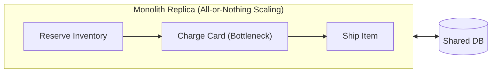
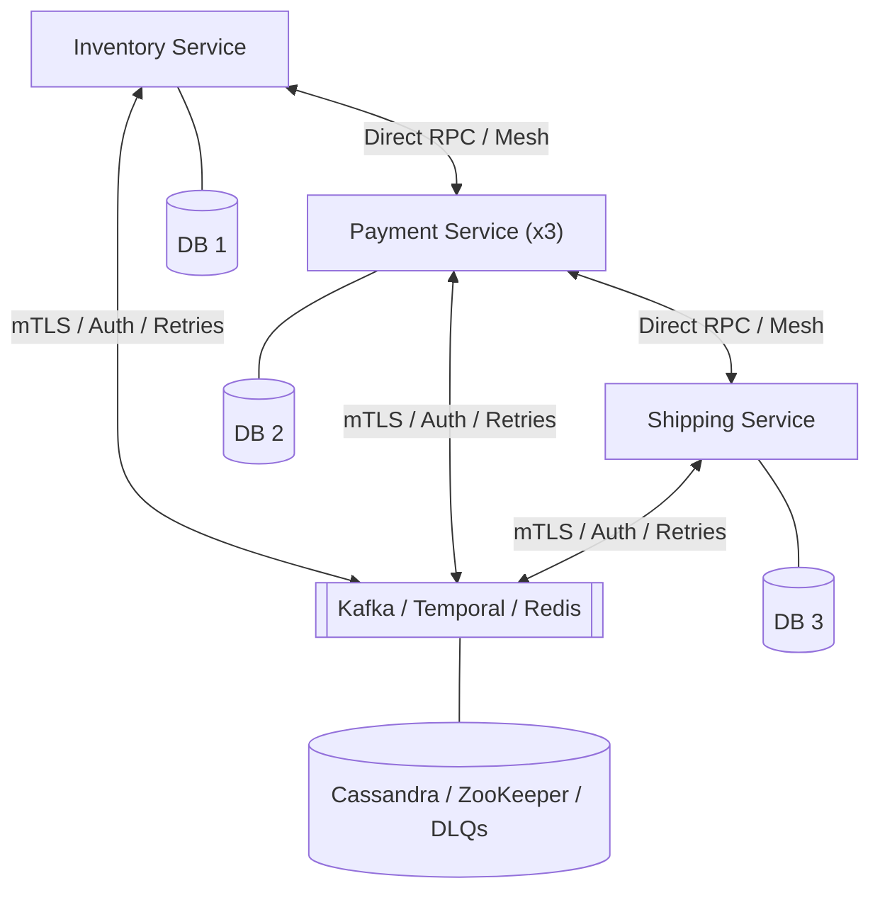
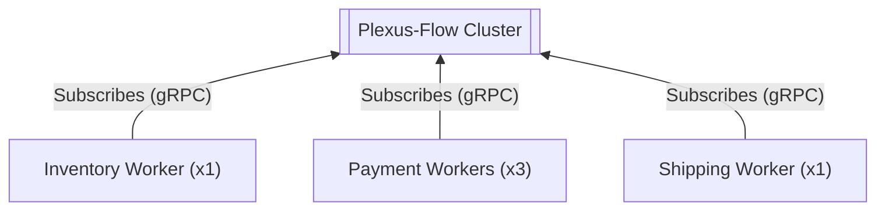
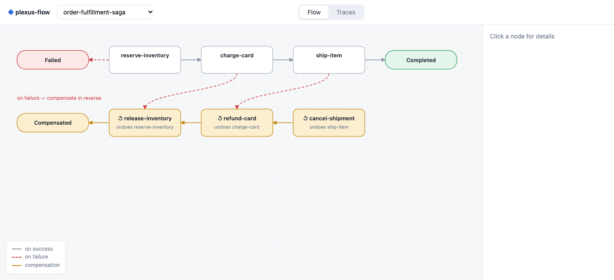
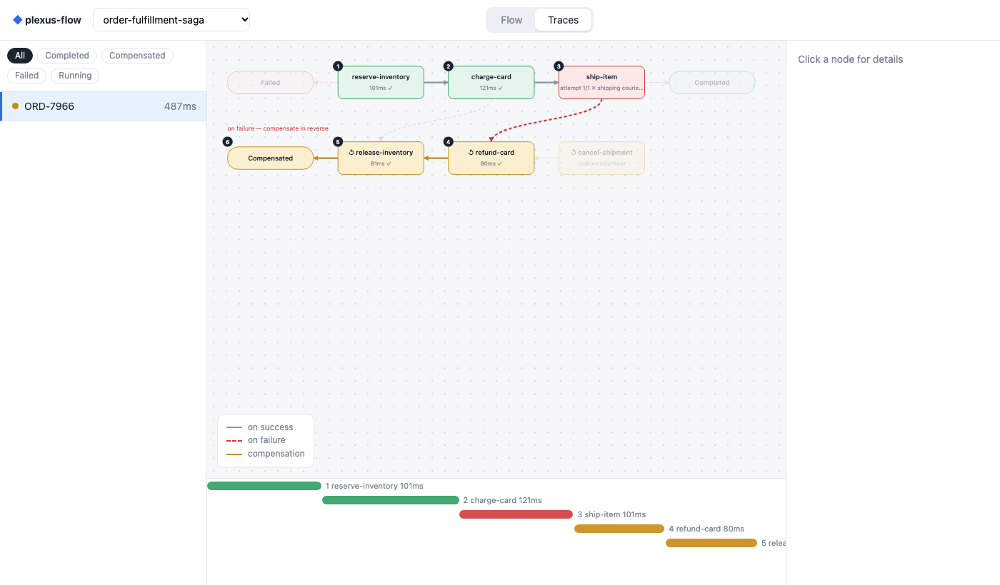
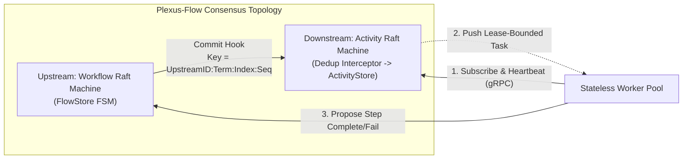

# Plexus-Flow

[](https://golang.org)
[](https://github.com/avivklas/plexus)
[-green.svg)](https://github.com/avivklas/plexus)

**Distributed Sagas & Multi-Step Workflow Orchestration without Temporal, Kafka, or fragile Redis locks.**

`plexus-flow` is a distributed workflow engine built on the **Plexus Raft Graph**. Start as a single binary with zero external dependencies, and independently scale any step horizontally by spinning up stateless worker processes—without managing service discovery, inter-service RPCs, message brokers, or distributed locks.

> Curious how `plexus-flow` solves dual writes, zombie workers, and split-brain without external brokers—and what the trade-offs are? Jump to [**Under the Hood: Distributed Systems Guarantees & Trade-offs**](#under-the-hood-distributed-systems-guarantees--trade-offs).

---

## Architecture Comparison: Monolith vs. Microservices vs. Plexus-Flow

### 1. Monolith — *Simple communication, hard to scale*
All steps are tightly coupled in one process. To scale a single CPU-heavy step (e.g., `charge-card`), you must duplicate the entire application and scale database connections with it. A process crash mid-flight loses in-memory execution state.



### 2. Microservices — *Granular scaling, operational & communication nightmare*
Each step is a separate service. Scaling is granular, but now every service needs service discovery, load balancers, mTLS/IAM policies, schema contracts, retry/circuit-breaker logic, idempotency tables, and external message brokers or orchestrators (Kafka, Temporal, Redis) just to talk to the next step and roll back on failure.



### 3. Plexus-Flow — *Monolith simplicity, per-step scaling, zero inter-service plumbing*
Workers **never talk to each other** and **never expose ingress ports**. `plexus-flow` owns workflow state, routing, deduplication, and LIFO Saga rollbacks. Activities can run **in-process** (like a monolith) and seamlessly burst out to **stateless remote workers** (in Go, Python, etc.) that subscribe over an outbound gRPC stream to pull work for specific steps.



---

## Why Plexus-Flow Wins on Deployment & Maintenance

| Dimension | Monolith | Microservices (Temporal / Kafka / Redis) | Plexus-Flow |
|---|---|---|---|
| **Scaling Granularity** | **Coarse:** Must clone the entire binary & DB pool to scale one slow step. | **Fine-grained,** but requires deploying & autoscaling full independent services. | **Per-step & elastic:** Run steps in-process by default; spin up stateless workers only for bottleneck activities. |
| **Inter-Service Communication** | Function calls in memory. | **High friction:** Service mesh, DNS/discovery, API versioning, circuit breakers, DLQs. | **Zero inter-service calls:** Workers never know about each other; `plexus-flow` pipes outputs to downstream inputs. |
| **Network & Access Control (Firewall/IAM)** | Single ingress; shared internal DB credentials. | **$O(N^2)$ ACLs:** mTLS certs, IAM roles, and firewall rules between every service pair and broker. | **Outbound-only workers:** Workers open no listening ports and need no service discovery—just subscribe to the cluster's gRPC address. |
| **Infrastructure Tax** | 1 App + 1 DB. | App fleet + Kafka + Temporal Server + Cassandra/Postgres + Redis. | **Zero external dependencies:** Consensus, storage, deduplication, and UI are embedded in the binary. |
| **Failure, Liveness & Rollback** | Lost on crash unless manually checkpointed to DB. | Custom compensation consumers, orphan sweepers, and manual lock timeouts. | **Built-in:** Automatic LIFO Saga compensation, worker heartbeats, dead-worker task redelivery, and step timeouts. |
| **Exactly-Once Semantics (EOS)** | Local DB transactions only; manual keys for external APIs. | Manual idempotency keys and deduplication tables in every microservice. | **Native EOS:** Deterministic Raft Graph keys (`UpstreamID:Term:Index:Seq`) enforced before dispatch. |
| **Safe Rollouts & Versioning** | Redeploy everything for a one-line change; risky migrations. | Coordinate multi-repo deployments and backward-compatible RPC schemas. | **Decoupled:** Upgrade or restart stateless activity workers at any time; the cluster buffers and redelivers in-flight tasks. |
| **Observability** | Single log stream / stack trace. | Stitch OpenTelemetry/Jaeger traces across dozens of queues and services. | **Built-in Flow & Trace Dashboard** + live SSE push streams out of the box. |

---

## Built-in Visibility: Flow & Trace Dashboard

In a monolith, business logic is hidden inside code branches; in microservices, it is scattered across repositories, message queues, and stitched-together OpenTelemetry spans.

A service built with `plexus-flow` is **self-describing**—just as a REST API schema tells you what endpoints exist, `plexus-flow` automatically exposes the complete **flow** (every activity and transition, including failure and rollback paths) and overlays live **traces** of actual runs directly on top of it. Zero external tracing infrastructure (Jaeger, Datadog, Zipkin) required.

Every node serves the interactive dashboard out of the box at `/`:

```bash
go run ./cmd/plexus-flow --run-example --simulate-failure --fail-step ship-item
# open http://127.0.0.1:8080
```

### 1. Flow View — *The Shape of Your Business Logic*
Derived automatically from your step dependencies and compensating actions—with nothing extra to declare. Solid grey edges show the happy path, red dashed edges show failure transitions, and amber nodes show the compensating actions that undo completed steps in reverse order. Click any node to inspect its activity, retries, timeout, dependencies, and compensation.



### 2. Traces View — *Live Execution & Rollback Inspection*
The exact same graph overlaid with a real execution: the path taken is highlighted and numbered step-by-step, untaken branches are faded, and each node displays its duration, attempt count, inputs/outputs, and errors. A live timeline below tracks execution progression in real time over Server-Sent Events (SSE).



---

## Quick Start

```bash
# Build
go build -o bin/plexus-flow ./cmd/plexus-flow

# Run happy-path Saga demo
./bin/plexus-flow --run-example

# Run automatic Saga rollback demo (simulates failure & reverse-order compensation)
./bin/plexus-flow --run-example --simulate-failure --fail-step charge-card
```

---

## Defining a Saga in Go

Activities run in-process via `worker.Registry`, or on remote workers subscribing over gRPC (`pkg/remote`)—the workflow definition stays identical:

```go
package main

import (
	"context"
	"encoding/json"
	"log"

	"github.com/avivklas/plexus-flow/pkg/flow"
	"github.com/avivklas/plexus-flow/pkg/flowstore"
	"github.com/avivklas/plexus-flow/pkg/graphflow"
	"github.com/avivklas/plexus-flow/pkg/worker"
)

func main() {
	registry := worker.NewRegistry()

	registry.Register("reserve-inventory", func(ctx context.Context, in json.RawMessage) (json.RawMessage, error) {
		return json.RawMessage(`{"reserved": true}`), nil
	})
	registry.Register("release-inventory", func(ctx context.Context, in json.RawMessage) (json.RawMessage, error) {
		return json.RawMessage(`{"released": true}`), nil
	})
	registry.Register("charge-card", func(ctx context.Context, in json.RawMessage) (json.RawMessage, error) {
		return json.RawMessage(`{"charged": true}`), nil
	})
	registry.Register("refund-card", func(ctx context.Context, in json.RawMessage) (json.RawMessage, error) {
		return json.RawMessage(`{"refunded": true}`), nil
	})

	coord, err := graphflow.NewEmbeddedCoordinator(registry)
	if err != nil {
		log.Fatal(err)
	}
	defer coord.Close()

	def := flow.WorkflowDefinition{
		Name: "ecommerce-order-saga",
		Steps: []flow.StepDefinition{
			{Name: "step-inventory", Activity: "reserve-inventory", CompensatingAction: "release-inventory"},
			{Name: "step-payment", Activity: "charge-card", CompensatingAction: "refund-card"},
		},
	}

	_, err = coord.StartWorkflow(context.Background(), flowstore.StartWorkflowRequest{
		WorkflowID: "order-1001",
		Definition: def,
		Input:      json.RawMessage(`{"amount": 149.99}`),
	})
	if err != nil {
		log.Fatal(err)
	}
}
```

### Push Watchers & HTTP API (`pkg/api`)

Instead of polling, clients subscribe to Server-Sent Events (SSE) pushed on every state transition:

```go
final, err := client.WaitWorkflow(ctx, "order-1001") // Go SDK: blocks until terminal state
```

```python
from plexus_flow import wait_for                    # Python SDK (stdlib only)
final = wait_for("http://127.0.0.1:8080", "order-1001")
```

| Endpoint | Description |
|---|---|
| `POST /api/v1/workflows/start` | Start a new workflow instance |
| `GET /api/v1/workflows/{id}` | Get workflow state (`POST .../signal`, `POST .../cancel`) |
| `GET /api/v1/workflows/{id}/watch` | SSE stream of state changes until terminal status |
| `GET /api/v1/flows` / `GET /api/v1/flows/{name}` | List known flows and inspect DAG + compensation edges |
| `GET /api/v1/traces/{workflowID}` | Execution trace overlaid on the flow graph |

---

## Under the Hood: Distributed Systems Guarantees & Trade-offs

Distributed workflow engines exist because **local state and remote side-effects cannot be updated in a single atomic transaction**. Below is how `plexus-flow` solves classic distributed systems failure modes using the **Plexus Raft Graph**, followed by the architectural trade-offs it makes.



### How Classic Distributed Failure Modes Are Solved

1. **The Dual-Write Problem (Update DB + Publish to Queue)**
   - *Classic failure:* A service commits a state change to Postgres, then crashes before publishing the next event to Kafka—leaving the workflow permanently stuck (or publishes first and crashes before the DB commit, causing phantom tasks).
   - *How `plexus-flow` solves it:* There is no separate database and message broker. An upstream **Workflow Raft Machine** (`FlowStore`) and a downstream **Activity Raft Machine** (`ActivityStore`) are wired via a **Raft Graph Pipe**. The Raft log *is* both the state store and the durable event log. Every committed workflow transition deterministically triggers the graph pipe to emit the next activity command.

2. **Duplicate Dispatch on Leader Failover (Exactly-Once State Transitions)**
   - *Classic failure:* A coordinator node dispatches a task, crashes mid-flight, and the new leader re-processes the uncommitted state—dispatching the same task twice.
   - *How `plexus-flow` solves it:* Every command emitted across the Raft Graph edge is stamped with a deterministic idempotency key derived from the upstream Raft log coordinate:
     $$\text{IdempotencyKey} = \text{UpstreamID}:\text{Term}:\text{Index}:\text{Seq}$$
     Before `ActivityStore` records or dispatches any task, an embedded `dedup.Store` interceptor verifies this key inside the downstream Raft machine. Even if a leader crashes and the new leader replays the pipe, duplicates are deterministically rejected at consensus level.

3. **Split-Brain & Stale Reads**
   - *Classic failure:* A network partition isolates an old leader or a replica serves stale workflow state, causing double execution or premature step advancement.
   - *How `plexus-flow` solves it:* All workflow mutations require a Raft quorum commit, and task dispatching is strictly gated by `IsLeader()`. Through Plexus's quorum-commit + local-apply synchronization, once a mutation returns, subsequent local memory reads on that node are strictly consistent without extra network round-trips.

4. **Zombie Workers, Crash Mid-Activity & Stale Completions**
   - *Classic failure:* A worker pulls a task and freezes (GC pause, network blackhole, OOM). Another worker picks up the timed-out task, and both eventually report back—corrupting workflow state.
   - *How `plexus-flow` solves it:* Workers maintain a liveness session via periodic heartbeats (`HeartbeatInterval`, default `2s`) and per-step execution deadlines. If a worker goes silent for 3 intervals, the broker marks it `WORKER_LOST` and redelivers or retries the task. When theUpstream Workflow FSM receives a completion/failure proposal, it validates the current `StepStatus` and `Attempt`—stale completions from zombie workers are safely ignored, and superseded in-flight tasks receive an active cancellation signal over their gRPC stream.

5. **Partial Failure Across Distributed Steps (Distributed Transactions without 2PC)**
   - *Classic failure:* Two-Phase Commit (2PC) holds cross-service locks and blocks availability whenever a single participant is slow or unreachable.
   - *How `plexus-flow` solves it:* First-class **LIFO Saga state machine**. When a step exhausts its retries, the workflow transitions to `COMPENSATING`. The state machine walks the completed DAG nodes in reverse completion order, piping `activity.compensate` commands through the same Raft Graph with automatic retries until the workflow reaches `COMPENSATED`.

### Architectural Trade-offs (What We Optimize For—and What We Don't)

No distributed system escapes the CAP and PACELC theorems. `plexus-flow` makes deliberate trade-offs to eliminate operational complexity:

| Trade-off | What `plexus-flow` Chooses | Why & When It Matters |
|---|---|---|
| **Write Throughput Ceiling vs. Zero-Infra Simplicity** | **Single Raft Group Consensus** per workflow machine (scales vertically and across a 3–5 node quorum, not horizontally sharded like Cassandra). | Every step transition writes a Raft log entry (`2 * Steps + 1` commits per workflow). Ideal for hundreds to low-thousands of state transitions/sec with sub-millisecond local disk I/O—not designed for millions of telemetry events/sec unless sharded across multiple independent `plexus-flow` clusters. |
| **CP (Consistency over Availability) under Partition** | **Strict Quorum (CP):** Minority partitions halt workflow advancement until quorum is restored. | Prevents split-brain double-charging or corrupted Saga state. Requires 3 or 5 nodes for high availability; if a majority of consensus nodes fail simultaneously, workflows pause safely rather than diverge. |
| **Memory-Resident State + Snapshots vs. Disk-Backed Query Engine** | **In-Memory FSM with Raft Log & Snapshots.** | Active and recent workflows live in memory for microsecond DAG evaluation and zero-latency SSE streaming. If you retain millions of historical completed workflows forever without archival/compaction, memory usage grows proportionally. |
| **Engine-Side EOS vs. External Side-Effects** | **Consensus-Level Dispatch EOS + At-Least-Once Worker Execution** on crash. | The Raft Graph guarantees a step transition emits a task *exactly once*. However, if a remote worker calls an external API (e.g., Stripe) and crashes *one nanosecond before* acknowledging completion to `plexus-flow`, the task will be redelivered. External side-effect handlers should still pass the provided deterministic task key (`WorkflowID:RunID:Step:Attempt`) to external APIs. |

---

## Testing

```bash
go test -v ./...
```

---

## License

MIT License. Built on top of [Plexus](https://github.com/avivklas/plexus).
